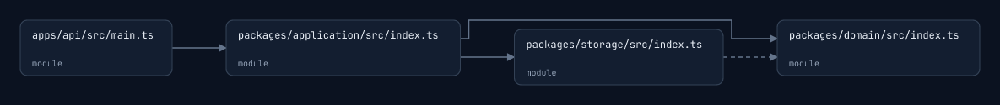

# vcli

[English](README.md) · [Русский](README.ru.md) · [简体中文](README.zh-CN.md)

英文 README 是主文档；其他辅助文档目前仍为英文。俄文和简体中文 README 翻译本指南；命令名称、配置键和 UI 标签保持不变。

一款以架构为先的编程智能体。探索源代码依赖图，声明组件边界，并在终端工作区中观察设计逐步转化为代码。

TypeScript · Bun · OpenTUI/Solid · SQLite · ELK · resvg



## 功能

- 探索**已观察到的**源代码依赖，声明**预期的**组件设计，并检查打开工作区以来的**变更**。在本地检查已声明的边界。
- 使用支持流式输出的 Markdown 聊天，在分屏和全屏视图之间切换，恢复已保存的对话，并查看持久化的工具卡片和完整结果文件。
- 先规划而不修改源代码，再明确启用实现。使用持久化任务、项目记忆、受保护的文件检查点、工具钩子和只读探索器。
- 连接五种提供商适配器之一，并明确选择模型、推理强度、权限模式和 token 预算。
- 按需发现 skills 和 MCP 工具，包括从受支持的插件和市场格式导入的组件。

源代码依赖分析主要使用 Compiler API 处理 TypeScript 和 JavaScript。其他可识别的源文件会显示为文件节点；更深入的语言分析尚未实现。架构扫描、布局、导航和导出都在本地运行，不调用模型。编程对话和模型探索器使用所选 API。

## 开始使用

使用下载的构建版本时，运行 `./vcli --root /path/to/your/project`。如果尚未准备好项目或提供商，可执行文件会打开欢迎界面。选择 **Open project** 和 **Connect provider**。按 **F1** 打开命令菜单，或按 **Esc** 返回提示符并输入 `/help`、`/open` 或 `/connect`。每个构建版本都附带[快速入门指南](docs/artifact-quickstart.md)。

下载的构建版本可独立运行；从源码开发时才需要 Bun。要从源码运行，请安装 **Bun 1.3.13** 和 **ripgrep**，然后执行：

```sh
git clone https://github.com/sl1ki0/vcli.git
cd vcli
git switch codex/architecture-first-cli
bun install --frozen-lockfile
bun run dev --root fixtures/sample-project
```

检测到 Kitty 或 Sixel 时，画布会使用真实图像。不支持图像的终端会显示可导航的树状视图。扫描、导航和导出不消耗模型 token。

通过 `/connect` 选择提供商和模型，也可以直接启动设置：

```sh
bun run dev setup --root fixtures/sample-project
```

设置流程会以掩码方式输入 API 密钥，并明确询问是仅在本次启动期间保留密钥，还是将密钥保存到当前用户专用的未加密凭据文件中。设置会保存到所选项目。密钥与项目配置分开保存，且不会出现在状态或配置输出中。也可以使用环境凭据，并通过现有 shell 配置：

```sh
bun run dev config set provider openai
bun run dev config set model YOUR_MODEL_ID
export OPENAI_API_KEY="YOUR_KEY"
bun run dev
```

| 提供商                             | 设置         | 凭据                                 |
| ---------------------------------- | ------------ | ------------------------------------ |
| OpenAI Responses                   | `openai`     | `OPENAI_API_KEY`                     |
| Anthropic Messages                 | `anthropic`  | `ANTHROPIC_API_KEY`                  |
| Gemini                             | `gemini`     | `GEMINI_API_KEY` 或 `GOOGLE_API_KEY` |
| OpenRouter Chat Completions        | `openrouter` | `OPENROUTER_API_KEY`                 |
| OpenAI-compatible Chat Completions | `compatible` | `VCLI_COMPATIBLE_API_KEY`（按需）    |

对于兼容服务，还要将 `baseURL` 设置为其 API 基础 URL。必须明确选择模型标识；vcli 不会假定用户使用订阅登录，也不会默认选择付费模型。默认上下文窗口为保守的 32,768 tokens。请将 `contextWindow` 设置为模型文档中注明的上限；准备上下文时会从中扣除输出预留量。

OpenRouter 默认使用 `https://openrouter.ai/api/v1`。通过 `/connect` 明确选择网关模型 ID，例如账户中的 `provider/model` ID。凭据按所选提供商和端点隔离。

**默认权限模式为 YOLO：**智能体会在不显示审批提示的情况下使用你的文件系统和网络权限。将 `permission` 改为 `ask` 或 `read-only`，也可以通过 `--permission` 为单次运行指定模式。如果没有可交互的审批渠道，Ask 模式会拒绝执行。权限控制不是文件系统沙箱。

在工作区中，审批请求会显示高亮菜单：**Allow once**、**Always allow this tool for this conversation** 或 **Deny**。使用 **Up/Down** 选择，再按 **Enter** 确认；按 **Esc** 拒绝。每个请求默认选中 **Deny**。使用 **Page Up/Down** 滚动查看详情。已记住的工具权限在该对话重启后仍然有效；新对话会重新询问。工具契约发生变化后也需要重新审批。Plan 和只读模式仍会拒绝变更。

## 聊天与架构工作区

工作区会同时显示架构和聊天。选择 **Chat**、按 **F2** 或输入 `/chat`，即可隐藏架构并将整个工作区用于对话。输入 `/split` 可恢复分屏；按 **F3** 或输入 `/architecture` 可展开画布。宽终端中的架构视图包含模块树和源码检查器；窄终端可在画布、树状视图和检查器面板之间切换。

发送后，你的消息会立即显示。回复会在其下方流式显示，并展示等待、思考、工具活动和取消状态。Markdown 支持标题、强调、行内代码、列表、链接、表格和代码块。点击消息或按 **Tab** 聚焦聊天进行导航；使用鼠标滚轮或 **Page Up/Down** 滚动。按 **Up/Down** 在消息间移动，按 **Home/End** 跳至首条或最新消息。按 **Esc** 返回提示符。在空提示符中按 **Up** 可调出已发送的消息。

打开 `/history`（也可用 `/sessions`）来选择已保存的对话。`/new` 会开始一个独立任务。历史记录保存在本地；即使发生中断，也会保存部分回复，且不受模型上下文预算影响。浏览和切换历史记录不会调用模型。

工具调用会以卡片显示操作、目标和状态：waiting、running、succeeded、failed、interrupted 或 blocked。错误会保留并显示；选择卡片后按 **Space/Enter**（或点击标题）可查看带标签的输入和结果预览。按 **F** 可在本地打开完整保存结果；按 **Left/Right** 翻页。卡片和结果句柄在重启后仍会保留；较早保存的会话会从本地事件日志恢复工具历史。

同一工具和 schema 问题连续出现三次参数验证错误后，当前任务会在再次请求模型之前停止。修正参数会重置该工具的计数。重启后停止状态仍会保留；发送新消息即可继续。权限拒绝和工具执行失败不计入此限制。

| 按键                 | 操作                                        |
| -------------------- | ------------------------------------------- |
| Tab                  | 在提示符、画布和聊天焦点间切换              |
| 方向键 / 鼠标点击    | 选择模块                                    |
| Shift + 方向键       | 平移                                        |
| `+` / `-`            | 缩放                                        |
| Enter                | 深入模块或分组                              |
| Space                | 折叠父级                                    |
| `v`                  | 在 Observed、intended 和 changes 视图间切换 |
| `/`                  | 搜索模块                                    |
| `t`                  | 切换侧边树；在窄终端中循环切换面板          |
| Escape               | 重置搜索、深入状态和视口                    |
| `r`                  | 从源码刷新                                  |
| Ctrl+C               | 停止当前任务；空闲时退出                    |
| 画布获得焦点时按 `q` | 退出                                        |
| F1                   | 打开命令菜单                                |
| F2                   | 切换全屏聊天和分屏视图                      |
| F3                   | 切换全屏架构和分屏视图                      |

| 提示符命令                                    | 用途                       |
| --------------------------------------------- | -------------------------- |
| `/help`, `/commands`                          | 打开命令菜单               |
| `/open`, `/connect`, `/config`, `/status`     | 项目、提供商和设置         |
| `/tokens`, `/reasoning`, `/permission`        | 预算、模型推理强度和权限   |
| `/chat`, `/split`, `/architecture`            | 工作区布局                 |
| `/history`, `/sessions`, `/new`               | 已保存和新建的对话         |
| `/observed`, `/intended`, `/changes`, `/scan` | 架构视图和刷新             |
| `/plan`, `/build`, `/plans`                   | 规划、实现和已保存的计划   |
| `/memory`, `/tasks`, `/hooks`                 | 查看本地工作流状态         |
| `/checkpoints`, `/rewind <id>`                | 查看并恢复已捕获的文件编辑 |
| `/plugins`, `/skills`                         | 查看可用扩展               |

在提示符中输入 `/` 可查看带说明的命令，并继续输入以筛选。使用 **↑/↓** 选择、按 **Tab** 补全，或按 **Esc** 隐藏建议并保留草稿。输入部分命令后按 **Enter** 会补全；再按一次才会运行。完整输入的命令按 Enter 会立即运行。`/permission` 和 `/reasoning` 也会建议支持的参数。点击建议可将其填入提示符。没有打开建议时，Tab 会循环切换焦点。建议不会调用模型。

配置和导航不会调用模型。`/tokens` 可调整上下文窗口、提示词/结果/schema/映射上限、响应预留量和任务预算。`/reasoning` 可选择 `default`、`none`、`minimal`、`low`、`medium`、`high`、`xhigh` 或 `max`。`default` 保留模型的原生行为；可用级别取决于提供商和模型。保存前会拒绝已知的不兼容选项。提供商返回的推理内容会显示在回复的可折叠区域中；不透明的续接数据与显示文本分开保存。

选择一条 assistant 消息并按 **Space** 或 **Enter**，可显示或隐藏其返回的推理内容；也可以点击推理区域。

`architecture_propose` 完成后，预期设计会立即显示，并先于后续变更操作。源码更改会触发重新协调；空闲期间的刷新也会检测外部编辑。变更会与打开工作区时的图进行比较。

```sh
vcli architecture scan --root ./project --json
vcli architecture view --root ./project --renderer kitty
vcli architecture export --root ./project --format png --output architecture.png
vcli architecture export --root ./project --format svg
vcli architecture export --root ./project --format json
vcli architecture check --root ./project
```

渲染器可覆盖为 `auto`、`kitty`、`sixel`、`blocks` 或 `off`。在多路复用终端中，Auto 会选择树状视图，除非明确请求图形模式。有关已测试行为和仍待完成的真实终端检查，请参阅[终端验证记录](docs/validation.md)。

预期组件和依赖规则保存在 `.vcli/architecture.json` 中。请提交该文件。派生索引、SQLite 会话和完整工具输出保存在 `.vcli/state/` 和 `.vcli/artifacts/` 中；请将这两个路径加入项目的 `.gitignore`。 [示例项目](fixtures/sample-project/.vcli/architecture.json)和[vcli 自身的设计](.vcli/architecture.json)展示了版本 1 格式。省略 `dependencies` 时，允许组件之间存在任意依赖；指定数组后则作为允许列表。`forbiddenDependencies` 优先级更高。漂移检查包含源码证据，发现违规时退出状态码为 1。

## 任务、会话和 token 预算

```sh
vcli run "Extract persistence into a storage component and verify the tests"
vcli run "Inspect the module boundaries" --permission read-only --json
vcli run "Plan the API boundary change" --plan --json
vcli sessions list
vcli sessions resume SESSION_ID "Continue and verify the result"
vcli sessions resume PLAN_SESSION_ID "Implement the plan" --build
```

`--json` 会输出以换行分隔的运行时事件，不含终端转义序列。中断的变更结果会保留在任务记录中，并在恢复时检查；vcli 不会自动重放这些操作。切换提供商会丢弃提供商专属的续接数据，同时保留可移植消息和任务状态。

平衡型默认值可调整：

| 设置                   |                      Default |
| ---------------------- | ---------------------------: |
| `context.promptTokens` |                  目标 32,000 |
| `context.mapTokens`    |                        4,000 |
| `context.schemaTokens` |                        4,000 |
| `context.resultTokens` |                        3,000 |
| `context.outputTokens` |                   预留 8,000 |
| `context.maxTurns`     |                           40 |
| `context.taskTokens`   | 未设置；需显式指定任务总上限 |

```sh
vcli config set context.taskTokens 100000
vcli config set permission ask --project
vcli config set reasoning high --project
vcli config show
```

优先级：CLI 选项 → 项目 `.vcli/config.json` → 用户 `~/.config/vcli/config.json` → 默认值。`VCLI_CONFIG_HOME` 可更改用户配置目录。凭据来自环境变量、本次启动期间的输入或独立的用户凭据存储。上下文大小估算方法为 UTF-8 字节数除以三；提供商报告的输入、输出和缓存用量会分别记录。不会重复加入未变更且重叠的读取内容，完整输出仍可检索；较早的完整工具组会被清理，同时保留持久化任务记录。本版本不使用付费摘要步骤。只有发现扩展 schema 和 skill 正文后才会加载。

每次模型调用前，任务预算都会为估算的输入和响应额度预留 token。收到用量报告后会据此调整预留；如果请求中断或没有用量报告，预留额度会在恢复时继续保留，因此缺少用量报告不会绕过上限。

[可复现的离线基准测试](docs/benchmarks.md)使用完整源码和完整 schema 提示词，对相同证据任务进行比较。它测量准备好的上下文和本地耗时；尚未确定真实模型的任务完成率和提供商账单节省情况。

## Skills、MCP 和市场

项目 skills 会从 `.vcli/skills`、`.agents/skills`、`.claude/skills`、`.gemini/skills` 和 `.qwen/skills` 中发现。受支持的 Agent Plugins、Claude 目录/包、Codex 目录/包、Gemini 和 Qwen 扩展以及 Qoder 包 会被转换为受支持的 skills 和 MCP servers。供应商的 hooks、commands、agents 和宿主 UI 功能会标记为不受支持。凭据和已连接的应用账户需要单独集成。

```sh
vcli plugins formats
vcli plugins inspect ./my-plugin
vcli plugins install ./my-plugin
vcli plugins install ./multi-host-plugin --format qwen
vcli plugins install https://github.com/team/plugins.git --ref COMMIT_SHA --subdir plugins/design
vcli plugins list
vcli plugins marketplace add team https://github.com/team/catalog.git --ref COMMIT_SHA
vcli plugins marketplace list
vcli plugins install design --marketplace team
vcli plugins marketplace refresh team
vcli plugins remove design
```

安装时会复制快照并记录来源。安装过程中不会运行 hooks。来源可以是本地目录或 Git 仓库。不支持归档/npm 安装、独立 HTTP catalogs、旧版 SSE 和交互式 OAuth。MCP stdio 程序和 HTTP 连接会在发现阶段通过权限门控后启动。其 schema 会延迟加载，参数会经过验证；已取消或结果不确定的调用不会重试。支持 stdio 和 Streamable HTTP 传输。有关配置、导入兼容性和存储限制，请参阅[integrations](packages/integrations/README.md)和[兼容性矩阵](docs/extension-compatibility.md)。

## 本地编程工作流

使用 `/plan` 进行探索并预览设计，不修改源码；然后使用 `/build` 实现计划。`/plans`、`/memory`、`/tasks`、`/hooks` 和 `/checkpoints` 可在不调用模型的情况下查看本地记录。只有文件仍与该编辑相符时，`/rewind <id>` 才会恢复已捕获的原生文件编辑。

该运行框架 会加载项目根目录中的指令，并支持经过修订版本校验的持久化记忆、依赖感知任务、前后置命令 hooks，以及最多两个共享父任务 token 预算的隔离只读模型探索器。原生文件列表和 Git diff 工具可通过延迟发现获取。

命令、hooks 配置、token 统计、检查点覆盖范围和功能支持矩阵，请参阅[本地工作流](docs/local-workflows.md)。这些功能是依据公开文档独立实现的；不声称与 Claude Code 完全兼容。

Plan 模式会在恢复时继续保留，并会拒绝源码编辑、shell、hooks 和 MCP 启动，即使权限模式为 YOLO 也如此。`/build` 会在已配置的权限下启用实现。重启后恢复实时草稿预览的功能仍未实现。自动加载的指令仅包括根目录中的 `AGENTS.md`、`CLAUDE.md` 和 `.vcli/MEMORY.md`，合计分配 2,000 tokens；不会解析嵌套指令和导入内容。探索器为只读模式，最多同时运行两个，每个最多六轮，默认从父任务预算中分配 12,000 tokens。检查点覆盖原生文件编辑，不包括 shell、MCP、memory 和 design 操作；检查点不会回退聊天记录。

## 仓库结构

| 路径                           | 职责                                              |
| ------------------------------ | ------------------------------------------------- |
| `packages/core`                | 可移植契约、智能体运行时、上下文、预算和权限      |
| `packages/architecture`        | 源码分析、预期设计、漂移检测、布局和 SVG/PNG 导出 |
| `packages/providers`           | 提供商 SDK 适配器、标准化流和续接状态             |
| `packages/integrations`        | 插件/市场标准化、skills 和延迟启动的 MCP 客户端   |
| `packages/tui`                 | 工作区展示、聊天和导航控制器                      |
| `apps/cli`                     | 命令、配置、工具、本地工作流和 SQLite 驱动        |
| `scripts`, `tests`, `fixtures` | 构建、smoke、基准测试和离线验证                   |

core 不导入终端、提供商 SDK、文件系统、子进程或 Bun 专属模块。架构引擎不运行推理；TUI 不拥有智能体工具。`.vcli/architecture.json` 声明并强制执行包之间的边界。

## 开发与打包

```sh
bun run format:check
bun run check
bun test
bun run dev architecture check
bun run benchmark
bun run build
bun run smoke
./dist/vcli --help
```

构建会为当前主机生成 `dist/vcli`，并嵌入布局 worker 和图形字体。分发时请包含整个 `dist/` 包，其中包括 licenses、notices、下载指南和 `WORKFLOWS.md`。CI 在 macOS 和 Linux 上运行，包括原生构建，以及在仓库目录之外进行的源码版/编译版伪终端检查。smoke 套件还会检查终端清理、图像输出和 256 的文件描述符限制。

测试使用离线 fixture 和本地提供商服务器；这些测试不能证明真实提供商的任务完成率或付费 token 节省情况。真实终端应用和 WSL 中的手动验证仍未完成。原生 Windows、浏览器/IDE 服务、订阅登录、后台/可写/自定义 agents 以及更深入的语言分析尚未实现。

[架构指南](docs/architecture.md)介绍契约和包边界。[研究说明](docs/research.md)记录公开参考资料和独立实现范围。格式检查由自动化工具执行；命令和工具按职责拆分到专用模块中，core 不导入终端库、提供商 SDK 或 Bun API。

## 文档

| 指南                                          | 内容                                     |
| --------------------------------------------- | ---------------------------------------- |
| [下载版快速入门](docs/artifact-quickstart.md) | 初始设置和启动故障排查                   |
| [架构](docs/architecture.md)                  | 契约、包边界、图和持久化状态             |
| [本地工作流](docs/local-workflows.md)         | 规划、记忆、任务、探索器、hooks 和检查点 |
| [集成](packages/integrations/README.md)       | Skills、插件清单和 MCP 配置              |
| [扩展兼容性](docs/extension-compatibility.md) | 支持的格式、市场和待解决的问题           |
| [验证](docs/validation.md)                    | 自动化验证证据和真实终端检查             |
| [基准测试](docs/benchmarks.md)                | 可复现的离线上下文估算                   |
| [研究](docs/research.md)                      | 公开参考资料和独立实现范围               |
