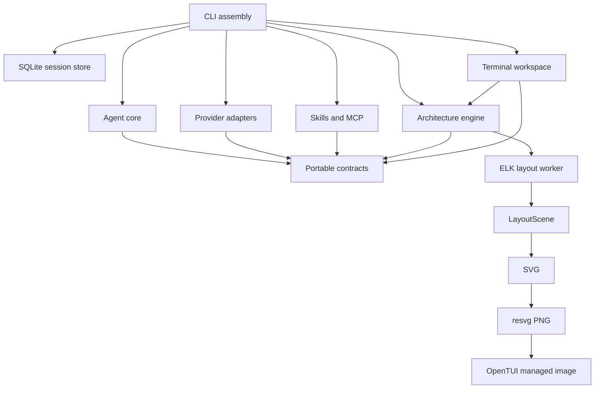

# Architecture

The agent runtime depends on contracts. The executable supplies implementations.
Terminal rendering and headless output consume the same typed events.

## Package ownership

| Package                 | Owns                                                               | Does not own                           |
| ----------------------- | ------------------------------------------------------------------ | -------------------------------------- |
| `packages/core`         | Runtime, budgets, context, permission policy, contracts            | SDKs, terminal IO, persistence drivers |
| `packages/architecture` | Compiler analysis, intended design, drift, layout, SVG/PNG         | Model inference or agent decisions     |
| `packages/providers`    | SDK requests, normalized streams, opaque continuation state        | Tool execution or permissions          |
| `packages/integrations` | Plugin imports, skills, lazy MCP connections                       | Vendor hooks or account login          |
| `packages/tui`          | Workspace state, interactions, visual presentation                 | Agent tools or SDK orchestration       |
| `apps/cli`              | Command dispatch, tool adapters, configuration, SQLite composition | General agent policy                   |

`ProviderAdapter`, `ToolRegistry`, `ContextPlanner`, `ArchitectureService`,
`SessionStore` and `ExtensionAdapter` are the stable integration seams. New
providers implement a stream adapter; they do not change the runtime. New clients
subscribe to `RuntimeEvent`; they do not parse rendered terminal text.

## Runtime lifecycle

1. Load or create the session, scan source, reconcile unfinished calls.
2. Prepare a budgeted prompt from stable system instructions, recent complete
   conversation groups, a ranked repository map and the task ledger.
3. Stream normalized provider events, preserving opaque continuation metadata.
4. Authorize tools, persist their start, execute independent reads in bounded
   batches and serialize mutations.
5. Save complete artifacts and bounded model results. Emit each mutation result
   before starting the next mutation, so design updates reach the UI before edits.
6. Rescan after effects and continue until completion, cancellation or budget stop.

The runtime's orchestration loop delegates recovery, inference and tool handling
to named methods. `SourceReadCache` owns overlap suppression and full-file revision
invalidation. Executor implementations are grouped by responsibility under
`apps/cli/src/tools`; commands are grouped under `apps/cli/src/commands`.
The terminal view consumes a controller; graph navigation owns selection, search
and viewport interactions separately from agent lifecycle and rendering.

Chat is split into conversation state, task execution, history navigation,
Markdown presentation and focus controls. The workspace controller assembles these
with a separate architecture canvas controller. Layout changes disable graphics
while chat is expanded, and shared canvas dimensions drive rendering and hit testing.

## Source facts and design

Observed module IDs derive from normalized project-relative paths. Renames become
removed/added IDs; unchanged paths retain IDs. Edges include evidence with file and
line locations. Unresolved and inferred relationships retain explicit labels.
Content hashes cache syntax facts; every scan resolves imports against the current
file list and compiler settings, so a deletion or alias change invalidates derived
relationships without reparsing unchanged syntax.

Intended components use explicit document IDs. Path rules map source modules to
components for drift checks. The observed graph, intended graph and workspace
change graph remain separate; declarations never manufacture observed imports.

`LayoutScene` is the sole geometry source for SVG generation and hit testing. Both
use the same pan/zoom transform. A worker isolates ELK; rendering is independent of
model text updates. Large graphs group modules and keep their member IDs for drill-down.

## Durable state

The versioned design belongs to Git. Index caches, sessions, usage events and full
artifacts remain local. A tool start is written before its effect; an interrupted
start without a completion becomes explicit uncertainty on resume. Recovery adds
an inspect-before-action constraint and never replays a mutation. Provider changes
remove opaque continuation fields while retaining portable task state.

`Session.chat` is the human conversation, separate from the provider's `messages`
and budgeted context selection. Message start, text/reasoning deltas and completion
events use stable message IDs. SQLite appends each event; snapshots and event
watermarks commit together, so recovery replays only newer deltas. Interrupted
streaming messages are marked canceled. A separate bounded metadata query lists
history without loading every conversation or constructing a provider.

Reasoning controls and provider-specific request fields belong to the adapters.
The core receives normalized text, reasoning, tools and usage events; encrypted
reasoning and signatures remain in opaque provider continuation metadata.

## Extending the system

Keep new side effects behind `ToolDefinition` and `PermissionGate`. Return concise
`text`, complete `fullOutput` and structured `details` separately. Use read-kind only
for operations whose effects are restricted to local derived state. MCP tools use
execute-kind because server annotations do not establish host trust.

Formatting is enforced by Prettier. Tests exercise contract behavior, not formatting
or private implementation details. The checked-in `.vcli/architecture.json` lets
`vcli architecture check` enforce the project's declared component dependencies.
